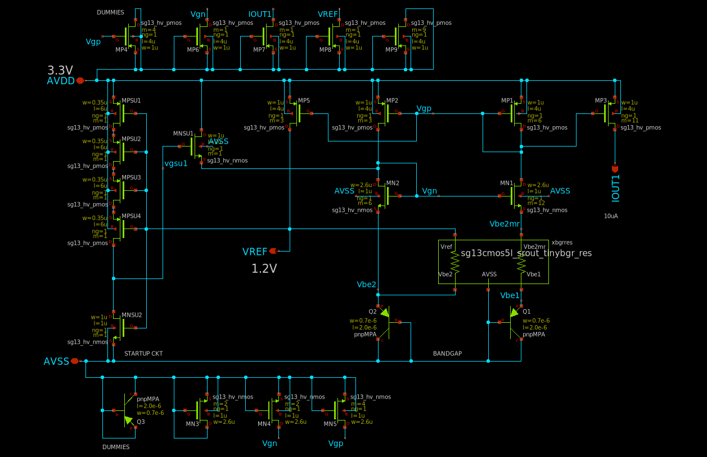

# Compact Bandgap Reference (BGR)
A compact bandgap reference (BGR) in IHP SG13CMOS5L as part of Chipalooza #2




This is a compact version of classic bandgap reference to provide designers the option of generating a bandgap voltage (1.2V) using a small area at the expense of performance. 
It is intended to fit inside an existing Pad without taking up extra area in the core. It can serve as reference for various application including LDOs, low-resolution converters, etc.

# Folder Structure

```
.
├── docs/        Documentation, characterization report, images
├── xschem/      Schematics, symbols and testbenches
├── netlist/     Testbench netlists exported from xschem
├── magic/       Layout (Magic VLSI) and DRC/LVS helper scripts
├── scripts/     GDS stream-out and netlist extraction scripts
├── verify/      LVS and post-layout simulation decks
├── gds/         Intermediate GDS and GDS artwork
└── final/       Final GDS for Chipalooza submission
```

- **docs/**: characterization report (`sg13cmos5l_srout_ip__tinyBGR_char.pdf`), schematic and floorplan images.
- **xschem/**: top-level BGR (`sg13cmos5l_srout_tinybgr.sch/.sym`), resistor sub-block (`sg13cmos5l_srout_tinybgr_res.sch/.sym`) and testbenches (`TB_tinybgr*.sch`) for DC characterization, AC and transient.
- **netlist/**: SPICE testbenches (`TB_tinybgr_DCchar`, `_AC`, `_tran`).
- **magic/**: top-level layout (`sg13cmos5l_srout_tinybgr.mag`), Chipalooza slot 15 wrapper (`slot15_wrapper.mag`) and generated device cells (`sg13_hv_nmos_*`, `sg13_hv_pmos_*`, `rhigh_*`, `pnpMPA_*`).
  - `drc_full.tcl`, `run_drc_mag.sh`: DRC in Magic.
  - `extract-lvs-net.tcl`: layout netlist extraction for LVS.
  - `lvs-debug/`: notes and outputs from debugging hierarchical vs. flat LVS.
- **scripts/**: `create_gds.sh` and `create_slot15_gds.sh` (GDS stream-out), `extract_lvs.sh`, `extract_pex.sh` and `extract_rcx.sh` (netlist extraction for LVS, with parasitics, and with full RC parasitics).
- **verify/**
  - `lvs/`: LVS flow (`netlist.sh`, `extract_net4lvs.sh`, `run_lvs.sh`); see `verify/lvs/README`.
  - `sims/`: testbenches with schematic, LVS-extracted, PEX and RCX netlists of the DUT for pre- vs. post-layout comparison.
- **gds/**: intermediate GDS (`tinybgr_floorplan.gds`, `slot15_wrapper.gds`) and `gdsart/` (GDS artwork with generation, render and DRC scripts).
- **final/gds/**: `slot_15.gds`, pulled automatically into the Chipalooza chip.

## Design Flow

1. Draw the schematic in `xschem/` and simulate (`netlist/`, `verify/sims/`).
2. Draw the layout in `magic/` and run DRC (`magic/run_drc_mag.sh`).
3. Extract (`scripts/extract_*.sh`) and run LVS (`verify/lvs/`).
4. Re-simulate with PEX/RCX netlists in `verify/sims/`.
5. Stream out GDS (`scripts/create_slot15_gds.sh`) to `final/gds/slot_15.gds`.

# Resources

- [Thomas Benz, et.al ArtisIC GDS art generator](https://github.com/pulp-platform/artistic) 
